# Post-contenido Unidad 10 — Memorias del Computador

**Arquitectura de Computadores · UFPS**
**Estudiante:** Diego Alferez · **Repositorio:** `Alferez-post10-u10`

Benchmark de jerarquía de caché (Parte 1) y análisis de memoria virtual en Linux (Parte 2), ambos en lenguaje C.

## Estructura del repositorio

```
Alferez-post10-u10/
├── README.md
├── parte1/cache_bench.c
├── parte2/mymaps.c
├── parte2/pagefault_demo.c
├── parte2/mmap_fault_cost.c
└── capturas/            (p1-cp1-1.png ... p2-cp5-2.png)
```

## Entorno

El estudiante desarrolló el laboratorio sobre Ubuntu (WSL2 en Windows) con gcc. Los programas se compilan con `-O0` para que el compilador no elimine los accesos a memoria que se miden.

```
gcc (Ubuntu 15.2.0-16ubuntu1) 15.2.0
Model name:                           AMD Ryzen 7 5700G with Radeon Graphics
```

---

# Parte 1: Benchmark de Jerarquía de Caché

**Objetivo.** El estudiante mide empíricamente la latencia de acceso a memoria para arrays de distintos tamaños y con tres patrones (secuencial, aleatorio y con stride fijo), e interpreta los resultados con los conceptos de localidad espacial, línea de caché, cache miss, TLB miss y conflict miss.

## 1.1 Detección de caché (Checkpoint 1)

```bash
cd parte1
for i in 0 1 2 3; do
  d=/sys/devices/system/cpu/cpu0/cache/index$i
  [ -d $d ] && echo "index$i: L$(cat $d/level) $(cat $d/type) size=$(cat $d/size) ways=$(cat $d/ways_of_associativity) line=$(cat $d/coherency_line_size)B"
done
lscpu | grep -i cache
```

```
index0: L1 Data size=32K ways=8 line=64B
index1: L1 Instruction size=32K ways=8 line=64B
index2: L2 Unified size=512K ways=8 line=64B
index3: L3 Unified size=16384K ways=16 line=64B
L1d cache:                             256 KiB (8 instances)
L1i cache:                             256 KiB (8 instances)
L2 cache:                              4 MiB (8 instances)
L3 cache:                              16 MiB (1 instance)
```

Valores registrados (por núcleo): **L1d = 32 KB** (8 vías, líneas de 64 B, 64 sets), **L1i = 32 KB** (8 vías), **L2 = 512 KB** (8 vías) y **L3 = 16 MB** (16 vías, compartida). `lscpu` muestra 256 KiB de L1d y 4 MiB de L2 porque suma las 8 instancias (una por núcleo): 8 × 32 KB y 8 × 512 KB. Estos tamaños determinan los puntos de inflexión que se esperan en el benchmark: cerca de 32 KB, 512 KB y 16 MB.

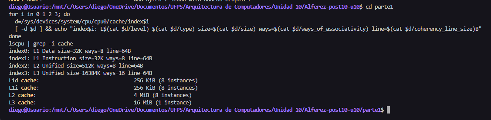
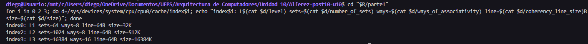

## 1.2 Benchmark secuencial (Checkpoint 2)

```bash
gcc -O0 -Wall -o cache_bench cache_bench.c
./cache_bench
```

`bench_seq` reserva un array de N bytes con `malloc`, lo inicializa con `memset` (para que las páginas ya estén asignadas antes de medir) y lo recorre 100 veces leyendo byte a byte con un puntero `volatile`, de modo que el compilador no pueda eliminar las lecturas. Mide con `clock_gettime(CLOCK_MONOTONIC)` y reporta ns por byte.

```
Array (KB)   seq (ns/byte)    seq (ns/linea)  rand (ns/acceso)
4                    0.706             0.832             1.067
8                    0.714             0.766             1.063
16                   0.729             0.760             1.100
32                   0.729             0.769             1.288
64                   0.740             0.821             1.161
128                  0.743             0.813             1.133
256                  0.750             0.814             1.220
512                  0.762             0.797             2.127   <-- salto L2 -> L3 (rand)
1024                 0.781             0.820             2.124
4096                 0.747             1.112             3.007   <-- sube seq (ns/linea): zona L3
16384                0.778             2.472            13.441   <-- salto L3 -> RAM (seq y rand)
65536                0.769             2.764            17.309
```

Puntos de transición observados: entre 256 KB y 512 KB la latencia del acceso aleatorio sube de 1.220 a 2.127 ns (L2 -> L3); entre 1 MB y 4 MB la lectura por línea empieza a subir (0.820 -> 1.112 ns/línea, zona L3); entre 4 MB y 16 MB el costo salta de 1.112 a 2.472 ns/línea y de 3.007 a 13.441 ns en acceso aleatorio (L3 -> RAM). La columna seq (ns/byte) permanece casi plana (0.706 a 0.781 ns/byte) porque 64 lecturas comparten cada línea de caché, el prefetcher de hardware anticipa el recorrido y el costo del bucle domina; por eso se añadió la columna seq (ns/linea), que lee un byte por línea y deja ver las transiciones. No se aprecia un salto claro entre L1 y L2 porque el prefetcher oculta esa latencia en el recorrido secuencial.

**Interpretación.** Mientras el array cabe en L1, casi todas las lecturas se sirven desde L1. Al superar cada nivel, una parte creciente de los accesos debe buscarse en el nivel siguiente, más lento, y la latencia media sube. En el recorrido secuencial el salto es moderado porque cada línea de 64 bytes se trae una sola vez y sirve para los siguientes 63 bytes (localidad espacial), y además el prefetcher de hardware detecta el patrón y trae las líneas por adelantado. Por eso el costo por byte crece mucho menos que el costo de un acceso aislado a RAM.

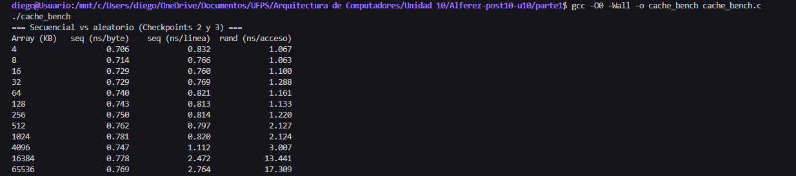
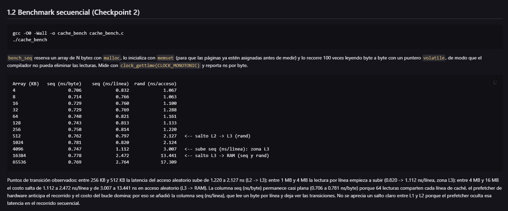

## 1.3 Acceso aleatorio vs secuencial (Checkpoint 3)

`bench_rand` genera un vector de índices, lo mezcla con Fisher-Yates y lee `arr[idx[i]]`, así que cada acceso cae en una posición impredecible. Reporta ns por acceso a un `int` (la columna secuencial reporta ns por byte, por lo que las unidades no son idénticas; lo que se compara es la forma de la curva). Se usan 10 repeticiones en lugar de 100 porque cada acceso aleatorio a RAM es mucho más lento.

La tabla de la sección 1.2 incluye la columna aleatoria.

**Interpretación.**

- Con arrays que caben en L1 o L2, ambos patrones son rápidos porque los datos ya están en caché.
- Al superar la caché, el acceso aleatorio crece mucho más que el secuencial: no hay localidad espacial, así que cada acceso es probablemente un cache miss y la línea de 64 bytes traída solo se aprovecha una vez. El prefetcher tampoco puede anticipar direcciones mezcladas.
- Una parte del salto en arrays grandes se atribuye a **cache miss** (el dato no está en L2/L3 y se baja a RAM) y otra a **TLB miss**: con páginas de 4 KB, un array de varios MB abarca cientos o miles de páginas, más que las entradas del TLB de primer nivel, y cada acceso aleatorio a una página sin traducción cacheada exige recorrer la tabla de páginas antes de acceder al dato.

Resultado observado: con 64 MB el acceso aleatorio costó 17.309 ns por acceso, frente a 0.769 ns/byte del secuencial (2.764 ns por línea con la lectura por línea). El salto grande aparece al pasar de 4 MB a 16 MB (3.007 → 13.441 ns), cuando el array deja de caber en la L3 de 16 MB (junto con el vector de índices) y los accesos se resuelven desde RAM. Antes hay un salto menor entre 256 KB y 512 KB (1.220 → 2.127 ns), donde el array deja de caber en la L2 de 512 KB y se sirve desde la L3. En el salto de 16 MB se atribuye además una parte a TLB miss, pues 16 MB equivalen a 4096 páginas de 4 KB.


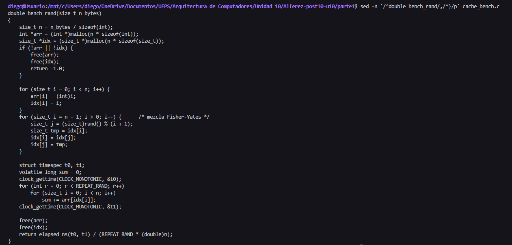

## 1.4 Stride y conflictos de asociatividad (Checkpoint 4)

`bench_stride` recorre un array de 1 MB saltando `stride` bytes entre accesos. Con 4096 B solo se leen 256 líneas distintas (16 KB en total, menos que los 32 KB de la L1), de modo que sin conflictos de asociatividad todas cabrían en la L1.

```
=== Stride sobre array de 1 MB (Checkpoint 4) ===
Stride            ns/acceso
64 B                  1.322
2048 B                1.716
4096 B                2.148
```

Resultado observado: con stride de 4096 B el acceso costó 2.148 ns frente a 1.322 ns con 64 B, entre 1.6 y 1.8 veces más (en otra ejecución con el mismo binario fueron 1.376, 1.845 y 2.509 ns), a pesar de que ambos recorren el mismo array de 1 MB. El stride de 2048 B quedó en un valor intermedio (1.716 ns): solo alterna dos sets de la L1, de modo que también sufre conflictos, pero cambia de página la mitad de las veces que el de 4096 B (dos accesos por página de 4 KB). Esta última relación con el TLB es una explicación plausible, no una causa medida por separado. La diferencia es moderada y no de un orden de magnitud porque los 256 accesos del stride de 4096 B abarcan solo 16 KB y, al fallar en L1, se resuelven desde L2 y no desde RAM.

**Interpretación.** Los tres experimentos usan el mismo array de 1 MB, por lo que la diferencia no se debe a un tamaño de trabajo distinto. Con stride de 4096 B todas las direcciones tienen los mismos bits de índice de set y compiten por las mismas vías de la L1 (conflict misses), por lo que cada acceso debe resolverse desde un nivel más lento. Con 64 B los accesos se reparten por todos los sets y el patrón es regular y prefetcheable. Cabe señalar que con 4096 B cada acceso también cae en una página distinta (256 páginas), lo que añade presión sobre el TLB de primer nivel; este experimento no aísla ambos factores, de modo que el efecto medido los combina y el conflicto de sets es la explicación principal según la geometría de la L1, no una causa medida por separado.

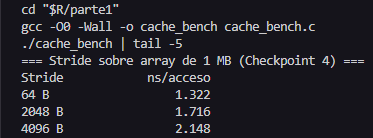
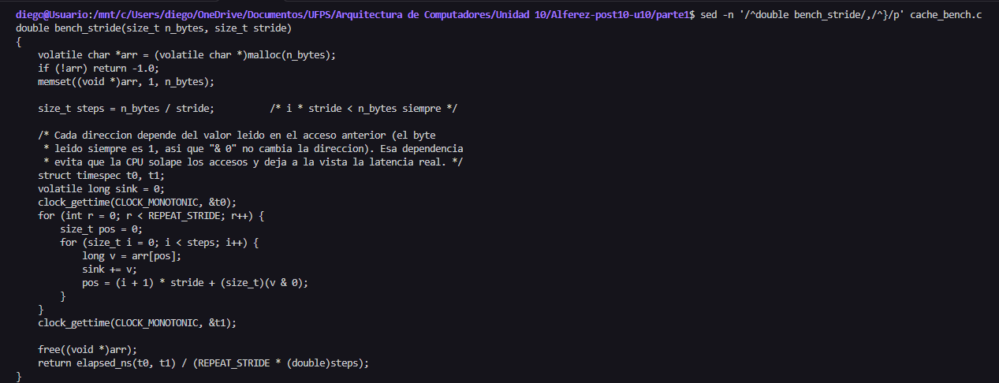

## 1.5 Decisión técnica 1: ¿qué stride expone mejor los conflictos de asociatividad?

Para una L1 de 32 KB, 8 vías y líneas de 64 bytes, el número de sets es 32 KB / (8 × 64 B) = 64. Una dirección se descompone en 6 bits de offset (bits 0-5), 6 bits de índice de set (bits 6-11) y el resto es etiqueta. El stride que garantiza que todos los accesos caigan en el mismo set es el tamaño total dividido entre las vías, 32 KB / 8 = 4096 bytes (64 sets × 64 B), porque un múltiplo de 4096 no modifica los bits 0-11 y por tanto el índice de set queda fijo; en este caso coincide con el tamaño de página. Con un stride de 2048 bytes los accesos no caerían todos en el mismo set: solo el bit 11 alterna, mientras los bits 6-10 permanecen constantes, así que se recorren únicamente dos sets de forma alternada. Con 4096 bytes sobre un array de 1 MB hay 256 líneas distintas compitiendo por un set de solo 8 vías. Desde el noveno acceso, cada línea nueva obliga a desalojar una de las ya presentes según la política de reemplazo, y como el recorrido es cíclico las líneas se expulsan antes de reutilizarse: casi todos los accesos fallan en L1 y se resuelven desde L2 o L3. Por eso cada acceso cuesta la latencia de un nivel inferior, mientras que en el acceso secuencial del Checkpoint 2 la mayoría de las lecturas se sirven desde L1.

## 1.6 Decisión técnica 2: ¿`-fno-prefetch-loop-arrays` deshabilita el prefetcher de hardware?

No. El flag `-fno-prefetch-loop-arrays` solo actúa sobre el compilador: evita que gcc inserte instrucciones de prefetch por software en bucles que recorren arrays. El prefetcher de hardware es un circuito del procesador que detecta patrones de acceso en tiempo de ejecución, sin intervención del compilador y sin que el binario lo mencione, por lo que el flag no lo afecta. Si `cache_bench.c` se compilara con `-O2 -fprefetch-loop-arrays` y luego con `-O2 -fno-prefetch-loop-arrays`, el patrón más sensible a la diferencia sería el secuencial, porque es el único cuyas direcciones futuras el compilador puede predecir y para el que puede insertar prefetch. El patrón aleatorio (índices mezclados con Fisher-Yates) y el de stride de 4096 bytes serían prácticamente insensibles: ningún prefetch insertado en tiempo de compilación puede anticipar direcciones que dependen de una mezcla pseudoaleatoria o de conflictos de asociatividad que ocurren en ejecución. Como el prefetcher de hardware no se puede desactivar de forma portable desde gcc (exige registros MSR o configuración de BIOS, según el modelo de CPU), comparar los dos flags solo mide el efecto del prefetch por software del compilador, no el del prefetcher de hardware. Es una conclusión limitada pero válida; además, como el hardware ya cubre el patrón secuencial, es posible que la diferencia medida sea pequeña o quede dentro del ruido.

## Checkpoint 5 de la Parte 1

Las dos decisiones técnicas anteriores (secciones 1.5 y 1.6) superan las 100 palabras cada una.

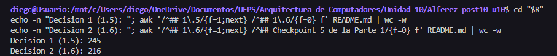
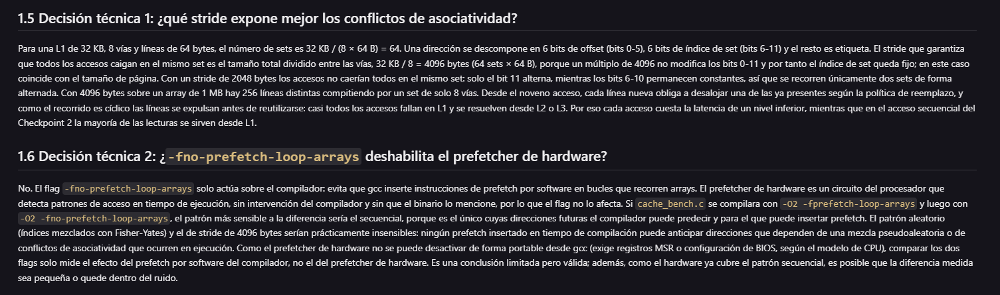

---

# Parte 2: Análisis de Memoria Virtual en Linux

**Objetivo.** El estudiante examina el espacio de direcciones de un proceso mediante `/proc/PID/maps` y `/proc/PID/smaps`, observa el crecimiento de la memoria residente por demand paging y mide el costo de un page fault individual con `mmap`.

## 2.1 Mapa de memoria virtual (Checkpoint 1)

`mymaps.c` imprime la dirección de una función (texto), una cadena (rodata), una variable global (datos), un bloque de `malloc` (heap) y una variable local (stack), y se pausa con `getchar()` para seguir vivo mientras se lee `/proc/PID/maps`. Como `getchar()` lee de la entrada estándar, el programa se ejecuta con `sleep 60 |` para mantener su entrada abierta y bloqueada en segundo plano:

```bash
cd ../parte2
gcc -O0 -Wall -o mymaps mymaps.c
sleep 60 | ./mymaps &
PID=$!
sleep 1
cat /proc/$PID/maps
kill $PID
```

```
[[PEGAR: salida de mymaps (PID y direcciones) y de cat /proc/$PID/maps]]
```

| Región | Entrada típica en `maps` | Permisos | Propósito |
|---|---|---|---|
| Texto (`.text`) | `/…/mymaps` | `r-xp` | Código ejecutable del programa |
| Solo lectura (`.rodata`) | `/…/mymaps` | `r--p` | Constantes y cadenas literales (como `"hola"`) |
| Datos (`.data`/`.bss`) | `/…/mymaps` y anónima contigua | `rw-p` | Variables globales inicializadas y sin inicializar |
| Heap | `[heap]` | `rw-p` | Memoria dinámica (`malloc` pequeño; un bloque de 1 MB puede ir en una región `mmap` anónima) |
| libc | `/…/libc.so.6` | `r--p`, `r-xp`, `rw-p` | Biblioteca compartida: código, constantes y datos propios de cada proceso |
| Cargador | `/…/ld-linux-x86-64.so.2` | `r-xp` y otras | Enlazador dinámico que carga las bibliotecas |
| Pila | `[stack]` | `rw-p` | Variables locales, direcciones de retorno, argumentos |
| vDSO | `[vdso]` | `r-xp` | Páginas del kernel mapeadas en el proceso para llamadas rápidas (p. ej. `clock_gettime`) sin cambio de modo |

La `p` final indica mapeo privado (copy-on-write). Las direcciones varían entre ejecuciones por ASLR.

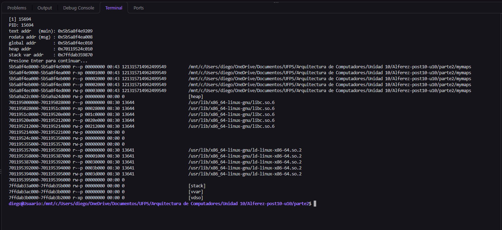
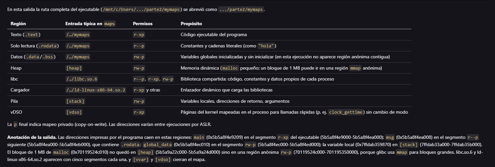

## 2.2 Clasificación de páginas con smaps y pmap (Checkpoint 2)

```bash
cat /proc/$$/smaps | head -60
pmap -x $$
awk '/^[0-9a-f]+-[0-9a-f]+ /{name=$6" "$1} /^(Rss|Shared_Clean|Private_Dirty):/{print name, $1, $2, $3}' /proc/$$/smaps | grep -E "libc|heap|stack"
vmstat -s | head -15
free -h
```

```
[[PEGAR: salida del awk (Rss, Shared_Clean y Private_Dirty de libc, heap y stack) y de pmap -x $$]]
```

Región Private_Dirty documentada: `[[heap o stack]]` con `[[XX]] kB`. Región Shared_Clean documentada: `libc.so.6` (segmento `r-xp`) con `[[XX]] kB`.

**Explicación.** El heap y el stack son memoria que el proceso escribe y que solo él posee: las páginas se modificaron (*dirty*), no tienen copia idéntica en disco y no se comparten con otros procesos (*private*), por eso son `Private_Dirty`. El código de `libc` proviene de un archivo, no se modifica y es idéntico para todos los procesos que lo usan, así que las mismas páginas físicas se comparten entre ellos (*shared*) y, al no haberse modificado, pueden descartarse y recargarse desde el archivo (*clean*): son `Shared_Clean`.

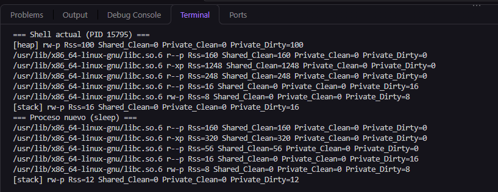
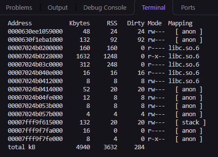

## 2.3 Page faults y crecimiento de VmRSS (Checkpoint 3)

`pagefault_demo.c` reserva 100 MB con `malloc`, imprime `VmPeak`, `VmSize`, `VmRSS` y los page faults acumulados (`getrusage`), ejecuta `memset` sobre todo el bloque y vuelve a imprimirlos. Lee `/proc/self/status` directamente desde C porque con `system("grep … /proc/self/status")` el `self` sería el proceso `grep`, no el programa.

```bash
gcc -O0 -Wall -o pagefault_demo pagefault_demo.c
./pagefault_demo
/usr/bin/time -v ./pagefault_demo 2>&1 | grep -E "Major|Minor|Maximum resident"
```

```
[[PEGAR: salida de ./pagefault_demo y de /usr/bin/time -v (Major y Minor page faults)]]
```

VmRSS antes del `memset`: `[[XX]] kB`; después: `[[XX]] kB` (diferencia ≈ 100 MB). Minor faults reportados por `time -v`: `[[XX]]`; major faults: `[[XX]]`.

**Explicación.** `malloc` de un bloque grande solo reserva direcciones virtuales (aparece en `VmSize`/`VmPeak`) y no asigna RAM física: el kernel usa asignación diferida (*demand paging*). Por eso `malloc` no provoca page faults inmediatos y `VmRSS` es pequeño antes del `memset`. Al escribir en cada página de 4 KB por primera vez ocurre un minor fault (la página no estaba en la tabla de páginas pero no requiere leer disco): 100 MB / 4 KB = 25 600 faults, que coincide con el aumento del contador. Un major fault, en cambio, exige leer del disco (por ejemplo, de swap o de un archivo mapeado); aquí no se esperan.

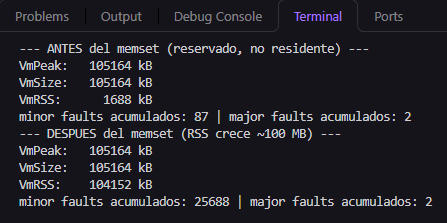
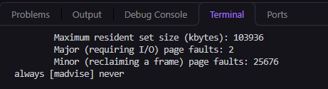

## 2.4 Costo de un minor page fault con mmap (Checkpoint 4)

`mmap_fault_cost.c` crea un mapeo anónimo de 200 páginas, mide con `clock_gettime` el primer toque de cada página (provoca el minor fault) y el segundo toque (la página ya está mapeada) y reporta el promedio de cada uno y su diferencia. El puntero a la página es `volatile` para que las escrituras no se eliminen.

```bash
gcc -O0 -Wall -o mmap_fault_cost mmap_fault_cost.c
for i in 1 2 3; do ./mmap_fault_cost; done
```

```
[[PEGAR: salida de las tres ejecuciones]]
```

Overhead atribuible al page fault: **`[[XX]]` ns** (promedio de las ejecuciones).

**Interpretación.** El primer toque incluye la trampa al kernel, la asignación y puesta a cero de un marco físico y la actualización de la tabla de páginas; el segundo solo paga el acceso normal más el costo de las dos llamadas a `clock_gettime`, que también está incluido en el primer toque y por eso se cancela al restar. El primer toque resulta consistentemente mayor que el segundo. Comparado con la latencia de un acceso a RAM medida en la Parte 1 (`[[XX]]` ns por acceso aleatorio con 64 MB), el costo de un minor fault es `[[de uno a dos órdenes de magnitud / ver resultado]]` mayor, ya que un fault ejecuta código del kernel además del acceso a memoria.

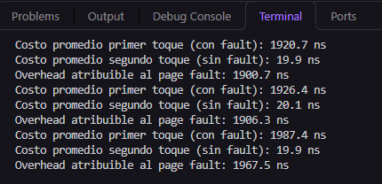
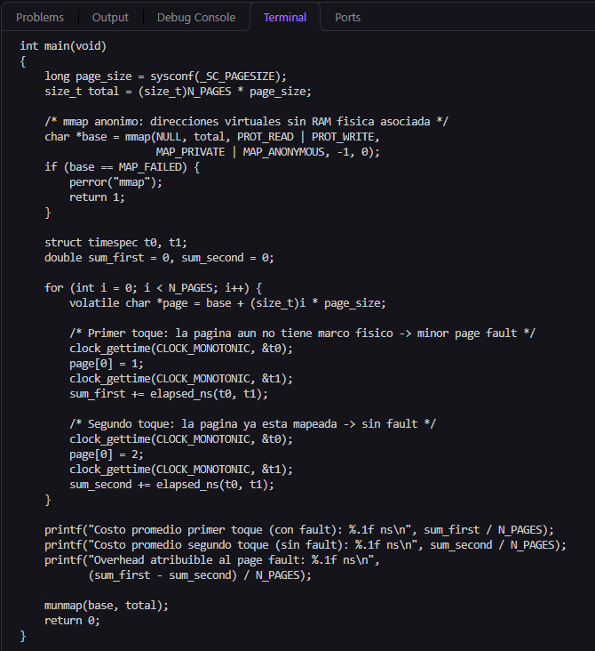

## 2.5 Decisión técnica 3: `/proc/PID/smaps` o `pmap -x`

`pmap -x` sí informa cuánta RAM (RSS) usa cada región mapeada del proceso, junto con el tamaño reservado (Kbytes), una columna Dirty combinada, los permisos y el nombre del mapeo. Lo que no expone es el detalle que sí ofrece `smaps`: la separación entre `Private_Dirty`, `Private_Clean`, `Shared_Dirty` y `Shared_Clean` dentro de cada región, y campos como `Referenced`, `Pss` o `Swap`. Esa separación fue indispensable en el Checkpoint 2 para distinguir las páginas del stack o heap (privadas y modificadas) de las del código de libc (compartidas y limpias). Por otro lado, leer `smaps` completo de un proceso con cientos de mapeos genera mucho volumen por región y es más costoso que leer `maps` o un resumen. En un script que consulta el estado de memoria cada segundo ese costo se acumularía, y convendría usar el resumen tabular de `pmap -x` (o, aún más liviano, `VmRSS` de `/proc/PID/status`), que basta si solo interesa el RSS. En una inspección rápida por terminal, `pmap -x` es preferible porque entrega una tabla ya resumida y con totales, sin filtrar a mano con `grep` o `awk`. En cambio, `smaps` se lee directamente cuando el análisis necesita saber qué tipo de páginas hay (compartidas o privadas, sucias o limpias) región por región.

## 2.6 Decisión técnica 4: `mmap` con `MAP_POPULATE` o demand paging

Si `mmap_fault_cost.c` usara `MAP_POPULATE`, el kernel prepararía las tablas de páginas y asignaría los marcos de todo el rango dentro de la propia llamada a `mmap`. El costo de los page faults se pagaría por adelantado, de modo que en el bucle las páginas ya estarían presentes y el tiempo del primer toque sería cercano al del segundo toque, en lugar del overhead medido en el Checkpoint 4. `MAP_POPULATE` conviene en un servidor que atiende peticiones y necesita latencia baja y predecible por petición: pagar la reserva al arrancar evita que una petición concreta sufra un fault en medio de su ejecución. El demand paging por defecto conviene a programas que reservan memoria de forma generosa o especulativa, porque solo se paga por lo que realmente se usa. Si un proceso reserva 100 MB con `mmap` pero solo toca 10 MB antes de terminar, el demand paging evita gastar tiempo de CPU y marcos físicos en los 90 MB restantes, desperdicio que sí ocurriría con `MAP_POPULATE`, que fuerza la asignación física de todo el rango sin importar cuánto se use. Un programa de arranque único que sabe que usará todo el buffer también se beneficia de `MAP_POPULATE`, ya que concentra el costo en un solo momento.

## Checkpoint 5 de la Parte 2

Las dos decisiones técnicas anteriores (secciones 2.5 y 2.6) superan las 100 palabras cada una.

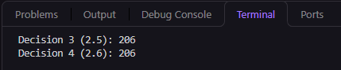

